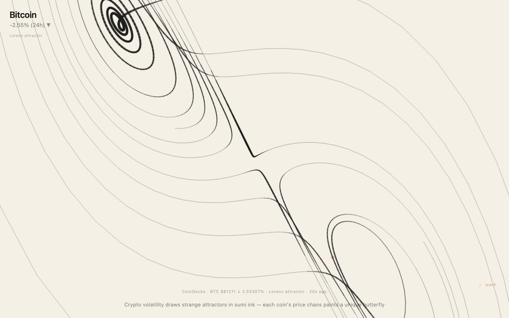

<div align="center">

<h1>trace</h1>

<p><b>Strange attractors drawn in sumi ink.</b></p>

<p><i>The past day's price swing for each of the top ten cryptocurrencies bends a Lorenz attractor. Calmer coins draw tighter wings.</i></p>

<h6>


</h6>

<a href="https://parthchandak02.github.io/trace/"><b>Live demo</b></a> ·
<a href="#how-it-works"><b>How it works</b></a> ·
<a href="#run-it"><b>Run it</b></a>

<br><br>

<a href="https://parthchandak02.github.io/trace/"></a>

<sub>Live capture, 22 October 2026, about 20 seconds after load. Real CoinGecko prices.</sub>

</div>

<br>

The page integrates the Lorenz system one step per frame and draws each step as a single brush
stroke on cream paper. The attractor's `rho` parameter comes from the selected coin's 24-hour price
change, so a volatile day draws wider, more chaotic wings than a quiet one. The data is the public
[CoinGecko](https://www.coingecko.com/en/api) `coins/markets` endpoint for the top ten coins by
market cap. No API key is needed.

## How it works

| Input | Drives |
|---|---|
| `price_change_percentage_24h` (absolute) | `rho` = 28 + change / 5, capped at 36. The value eases in instead of jumping |
| Speed of the point along the curve | Stroke width: slow sections are thick (up to 7 px), fast ones thin to 0.5 px |
| Height of the point (`z`) | Ink darkness: higher points draw slightly lighter |
| Coin id | Seeds the starting point, so each coin draws a different path |
| Every 300 steps | A faint vermillion dot, like a seal stamp |

Each coin starts with 6,000 hidden warm-up steps so the drawing begins on the attractor rather than
spiralling in from the origin. Every 300 frames a 2% wash of paper colour fades older strokes, and
after 5,000 steps the page washes the paper and starts the path again. Prices refresh every two
minutes; if CoinGecko can't be reached, a fixed three-coin fallback is used.

Click or tap anywhere to move to the next coin.

## Run it

It is a single `index.html` with no build step and no dependencies.

```bash
git clone https://github.com/parthchandak02/trace.git
cd trace
python3 -m http.server 8000   # then open http://localhost:8000
```

All tunables (`sigma`, `rho`, `beta`, step size, fade timing, stroke widths, API URL) are in the `C`
object at the top of the script, and colours are in `P`.

<br>

<div align="center">
<sub>Built with the Canvas 2D API. Data from CoinGecko.</sub>
</div>
